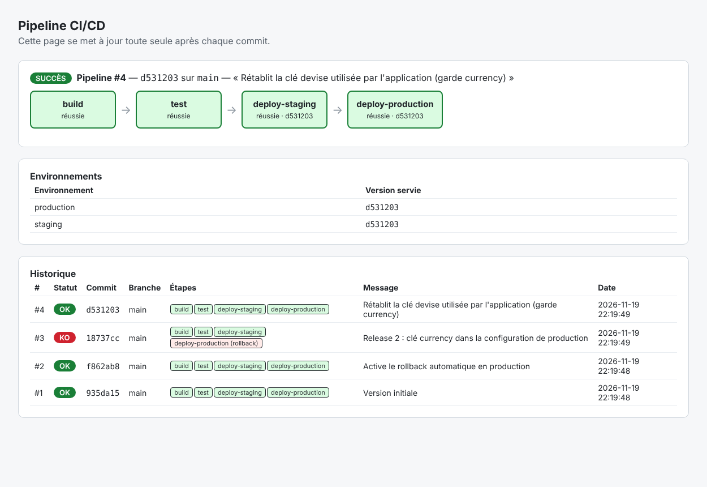
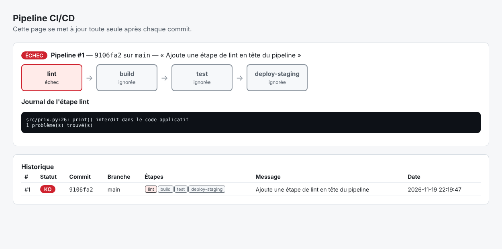

# Simulateur de pipeline CI/CD : labs guidés avec vérification automatique

Didacticiel pour apprendre l'intégration et le déploiement continus (CI/CD) par la pratique. L'étudiant modifie une application dans un dépôt Git : **chaque commit déclenche un pipeline** (lint, build, tests, quality gate, déploiement en staging puis en production, rollback), qu'il voit réagir dans son terminal et sur une page web qui se met à jour toute seule. Six labs progressifs, chacun vérifié et noté sur 20 automatiquement.

Public : élèves ingénieurs (2e/3e année), modules DevOps / Génie logiciel.
Prérequis : bases de Git et de Python. Aucun service en ligne n'est nécessaire : tout tourne sur le poste de l'étudiant.



## Parcours

| Lab | Thème | Notions | Durée |
|---|---|---|---|
| 01 | Premier pipeline | commit, déclenchement, étapes, staging | 25 min |
| 02 | Casser et réparer | lecture des journaux, blocage du déploiement, correctif par un nouveau commit | 25 min |
| 03 | Ajouter une étape : le lint | définition du pipeline, *fail fast*, règles de code | 25 min |
| 04 | Quality gate de couverture | couverture de tests, seuil bloquant, tests de mutation | 30 min |
| 05 | Branches | intégration continue sur toutes les branches, déploiement depuis `main`, fusion | 35 min |
| 06 | Production et rollback | contrôle de santé, retour arrière automatique, gestion d'incident | 35 min |

## Installation

```bash
git clone https://github.com/ELHAMLAOUI/cicd-pipeline-educational-software.git
cd cicd-pipeline-educational-software
pip install -r requirements.txt     # pyyaml, coverage
./pipectl list
```

Python 3.8 ou plus et Git suffisent. Sous Windows, remplacez `./pipectl` par `python engine/pipectl.py` (ou utilisez WSL / Git Bash).

## Utilisation

| Commande | Rôle |
|---|---|
| `./pipectl list` | liste les labs |
| `./pipectl start NN` | crée l'espace de travail `workspace/labNN` (dépôt Git + hooks) |
| `./pipectl status NN [--last]` | historique des pipelines et version servie par chaque environnement |
| `./pipectl open NN` | ouvre la page de suivi dans le navigateur |
| `./pipectl run NN` | relance le pipeline à la main, sans commit |
| `./pipectl hint NN` | affiche les indices |
| `./pipectl check NN` | vérifie le travail et donne une note sur 20 |
| `./pipectl reset NN` | repart de zéro sur le lab |
| `./pipectl report` | vérifie tous les labs, exporté dans `results/rapport.csv` |
| `./pipectl pack` | crée l'archive de rendu de l'étudiant |
| `./pipectl grade rendu.zip` | (enseignant) note une archive de rendu |

Depuis un espace de travail (`workspace/labNN`), utilisez `../../pipectl`.

## Le pipeline : `pipeline.yml`

```yaml
name: boutique
stages:
  - name: lint
    run: python tools/lint.py src        # commande shell ; échec = code retour non nul
  - name: build
    run: python -m compileall -q src
  - name: test
    run: python -m unittest discover -s tests -v
    coverage_min: 80                     # quality gate : couverture minimale (%)
  - name: deploy-staging
    deploy: staging                      # déploiement intégré + contrôle de santé
    when: branch == main                 # condition sur la branche (motifs : feature/*)
  - name: deploy-production
    deploy: production
    on_failure: rollback                 # retour à la version précédente si le contrôle échoue
```

Les étapes s'exécutent dans l'ordre. Si une étape échoue, les suivantes sont ignorées. Un déploiement copie la version dans `.pipeline/env/<environnement>/releases/<commit>/`, puis exécute `healthcheck.py`.

## Exemples d'usage

### 1. Premier pipeline (lab 01)

```bash
$ ./pipectl start 01
Lab 01 — Premier pipeline : du commit au déploiement
Espace de travail : workspace/lab01

Lisez l'énoncé : labs/lab01/README.md
Puis : cd workspace/lab01

$ cd workspace/lab01
$ ../../pipectl open 01          # la page de suivi s'ouvre et se rafraîchit toute seule
```

L'étudiant ajoute la fonction `prix_ht_depuis_ttc` et son test, puis commite. Le pipeline se déclenche immédiatement :

```bash
$ git add -A
$ git commit -m "Ajoute le calcul du prix HT depuis le TTC"

Pipeline #1 — commit 1512c39 (main) « Ajoute le calcul du prix HT depuis le TTC »
  [OK] build               0.0 s
  [OK] test                0.1 s
  [OK] deploy-staging      0.0 s  staging -> 1512c39
Résultat : SUCCÈS  (0.1 s)
Page de suivi : .pipeline/status.html

$ ../../pipectl check 01

Lab 01 — Premier pipeline : du commit au déploiement
--------------------------------------------------------------
  [OK] Un nouveau commit a été créé (+2)
  [OK] Le commit a déclenché un pipeline (+2)
  [OK] prix_ht_depuis_ttc est correcte (120 -> 100.0, 11.99 -> 9.99) (+3)
  [OK] Un test mentionne prix_ht_depuis_ttc (+2)
  [OK] Le test détecte une fonction fausse (test de mutation) (+2)
  [OK] Le dernier pipeline (sur le dernier commit) est vert (+2)
  [OK] Staging sert la version du dernier commit (+2)
--------------------------------------------------------------
Lab 01 réussi : 15/15 points — note 20.0/20
```

### 2. Un commit casse le pipeline (lab 02)

Au démarrage du lab, un « collègue » commite une modification boguée. Le test échoue et **le déploiement est bloqué** :

```text
Pipeline #1 — commit 06e840e (main) « Remise de fin d'année : optimisation du calcul »
  [OK] build               0.0 s
  [KO] test                0.1 s
       FAIL: test_remise_10 (test_prix.TestRemise.test_remise_10)
       ...
           self.assertEqual(appliquer_remise(200, 10), 180.0)
       AssertionError: 0.0 != 180.0
       FAILED (failures=1)
  [--] deploy-staging      ignorée : étape précédente en échec
Résultat : ÉCHEC  (0.08 s)
```

L'étudiant doit corriger **le code** par un nouveau commit. S'il « corrige » le test pour qu'il accepte la mauvaise valeur, la vérification le détecte :

```text
  [KO] La remise est corrigée : appliquer_remise(200, 10) = 180.0 (0/3)
  [KO] La correction est dans le code, les tests sont intacts (0/3)
      tests/test_prix.py a été modifié
  [KO] Staging sert la version corrigée (0/2)
      la version servie en staging calcule appliquer_remise(200, 10) = 0.0
```

### 3. Fail fast : le lint bloque tout (lab 03)

Une fois l'étape `lint` ajoutée en tête du pipeline, un `print()` oublié suffit à arrêter le pipeline avant le build :

```text
Pipeline #1 — commit 9106fa2 (main) « Ajoute une étape de lint en tête du pipeline »
  [KO] lint                0.0 s
       src/prix.py:26: print() interdit dans le code applicatif
       1 problème(s) trouvé(s)
  [--] build               ignorée : étape précédente en échec
  [--] test                ignorée : étape précédente en échec
  [--] deploy-staging      ignorée : étape précédente en échec
Résultat : ÉCHEC  (0.02 s)
```



### 4. Quality gate de couverture (lab 04)

```text
Pipeline #1 — commit 4bff5e9 (main) « Ajoute un seuil de couverture de 80 % »
  [OK] build               0.0 s
  [KO] test                0.2 s
       Name          Stmts   Miss  Cover
       ---------------------------------
       src/prix.py      16      6    62%
       Quality gate : couverture 62 % inférieure au seuil de 80 %
  [--] deploy-staging      ignorée : étape précédente en échec
Résultat : ÉCHEC  (0.24 s)
```

La vérification utilise des **tests de mutation** : elle introduit un défaut dans une copie du code, par exemple un total calculé sans TVA. Si les tests de l'étudiant ne le détectent pas, ils sont jugés insuffisants, même avec 100 % de couverture.

### 5. Branches : intégration continue partout, déploiement depuis main (lab 05)

```bash
$ git switch -c feature/remise-fidelite
$ git commit -am "Ajoute la remise de fidélité (1 % par an, plafond 10 %)"   # build + test, pas de déploiement
$ git switch main
$ git merge feature/remise-fidelite                                         # la fusion déclenche le pipeline sur main

$ ../../pipectl status 05
  #  Statut  Commit   Branche                  Étapes / message
  1  SUCCÈS  d51097e  main                     OK:build OK:test OK:deploy-staging
                      « Ne déploie en staging que depuis main »
  2  SUCCÈS  69fd05b  feature/remise-fidelite  OK:build OK:test --:deploy-staging
                      « Ajoute la remise de fidélité (1 % par an, plafond 10 %) »
  3  SUCCÈS  69fd05b  main                     OK:build OK:test OK:deploy-staging
                      « Ajoute la remise de fidélité (1 % par an, plafond 10 %) »

Environnements : staging -> 69fd05b
```

### 6. Incident en production et rollback automatique (lab 06)

La « release 2 » passe les tests et le déploiement en staging, mais le contrôle de santé de production échoue. Le rollback remet en service la version précédente :

```text
Pipeline #3 — commit 18737cc (main) « Release 2 : clé currency dans la configuration de production »
  [OK] build               0.0 s
  [OK] test                0.0 s
  [OK] deploy-staging      0.0 s  staging -> 18737cc
  [KO] deploy-production   0.0 s
       Déploiement de la version 18737cc en production (précédente : f862ab8)
       Contrôle de santé : KO — clé « devise » absente de config/production.json
       ROLLBACK : production revient à la version f862ab8
Résultat : ÉCHEC  (0.12 s)
```

### 7. Rendu et notation

L'étudiant crée son archive de rendu, qui contient tous ses labs avec leur historique Git et leurs pipelines :

```bash
$ ./pipectl pack
Rendu créé : rendu-2026-11-19.zip (à déposer sur la plateforme du cours)
```

L'enseignant la note sur son propre poste :

```bash
$ ./pipectl grade rendu-2026-11-19.zip
...
Lab 06 réussi : 15/15 points — note 20.0/20
Rapport global : 90/90 points — note 20.0/20 (notes-rendu-2026-11-19/rapport.csv)
```

Le fichier `rapport.csv` s'ouvre dans un tableur (une ligne par lab, avec le total). Le détail de chaque vérification est enregistré dans `labNN.json`.

## Fonctionnement

- `./pipectl start NN` copie l'application d'exemple (`labs/_app`) et les fichiers propres au lab dans `workspace/labNN`. Il initialise un dépôt Git et installe les hooks `post-commit` et `post-merge`, qui lancent le pipeline.
- Le moteur (`engine/pipeline.py`) exécute les étapes, enregistre chaque exécution dans `.pipeline/runs/NNNN.json` et régénère `.pipeline/status.html`.
- Chaque `labs/labNN/check.py` inspecte l'espace de travail : historique Git, exécutions du pipeline, configuration, code. Il exécute aussi des contrôles actifs : appel des fonctions de l'étudiant, tests de mutation, contrôle de santé de la version déployée.
- L'état de départ de chaque lab vaut **0 point** : aucune vérification n'est validée sans travail de l'étudiant.

## Solutions de référence

Les solutions ne sont pas dans la branche `main` : elles sont dans la branche **`solutions`**.

```bash
git fetch origin solutions
git archive FETCH_HEAD solutions | tar -x      # le dossier solutions/ est ignoré par Git sur main
bash solutions/apply-all.sh                     # démarre chaque lab et applique sa solution
./pipectl report                                # attendu : 90/90 points — note 20.0/20
```

## Tests du didacticiel

`tests/run-tests.sh` exécute de vrais scénarios (vrais dépôts Git, vrais hooks, vrais pipelines) :

- **départ** : chaque lab vaut 0 point sans travail ;
- **solutions** : 20/20 à chaque lab ;
- **rendu** : `pack` puis `grade` donnent 90/90 ;
- **erreurs** : des erreurs et tricheries typiques (`tests/wrong/`) sont détectées.

Ces tests sont lancés à chaque push par `.github/workflows/tests.yml`.

## Structure

```
pipectl                 pilote (raccourci vers engine/pipectl.py)
engine/pipeline.py      moteur : exécution des étapes, déploiement, rollback, couverture
engine/status_page.py   page de suivi HTML
engine/checks.py        bibliothèque de vérification et de notation
labs/_app/              application d'exemple (boutique) : src, tests, healthcheck, linter
labs/labNN/             README.md (énoncé), hints.md, lab.py (mise en place), check.py, files/
tests/                  tests de bout en bout et scénarios d'erreurs
docs/                   captures d'écran
```

## Ajouter un lab

Créez `labs/labNN/` avec un énoncé (`README.md`), des indices (`hints.md`), et éventuellement des fichiers qui remplacent ceux de l'application (`files/`). Ajoutez ensuite un `lab.py` qui contient `TITLE` et, si besoin, `setup(ctx)` (commits ou pipelines initiaux), puis un `check.py` :

```python
import os, sys
sys.path.insert(0, os.path.join(os.path.dirname(os.path.abspath(__file__)), "..", "..", "engine"))
from checks import Lab, commit_runs

lab = Lab("07", "Mon nouveau lab")

def dernier_vert():
    runs = commit_runs(lab.runs())
    return bool(runs) and runs[-1]["status"] == "success", "aucun pipeline vert"

lab.check(3, "Le dernier pipeline est vert", "Commitez votre travail.", dernier_vert)
lab.run()
```

Le barème se calcule automatiquement à partir des points déclarés.
